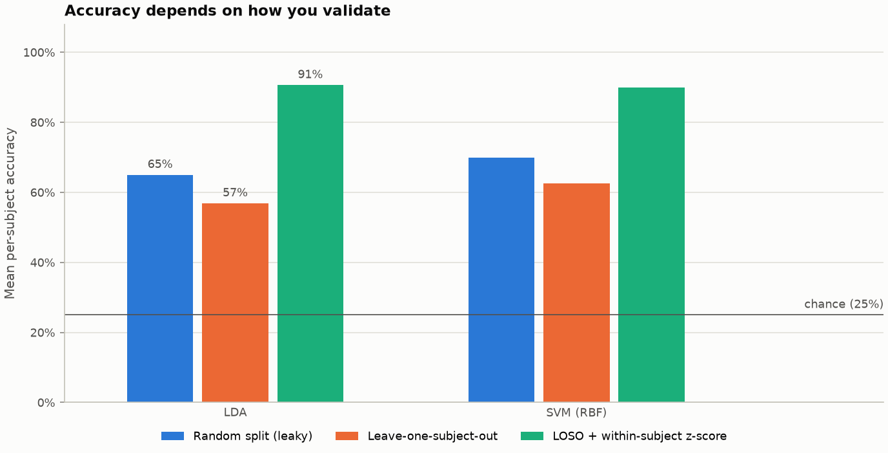
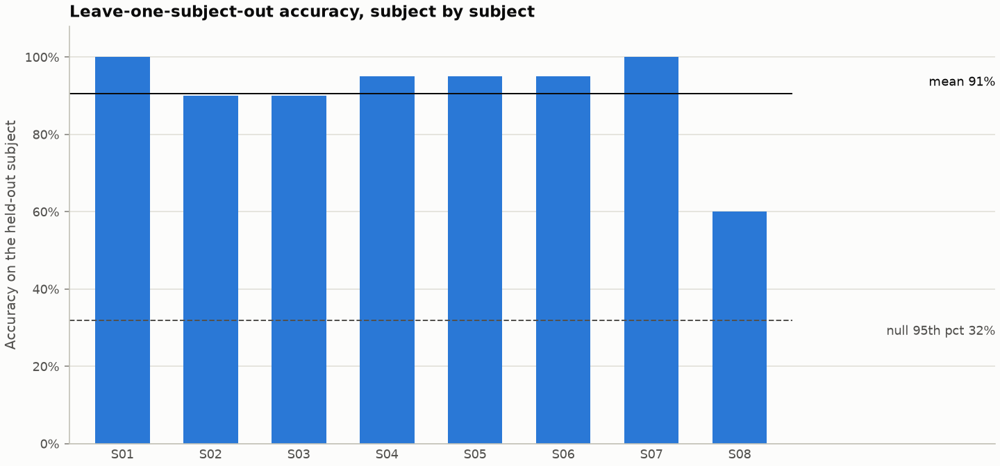
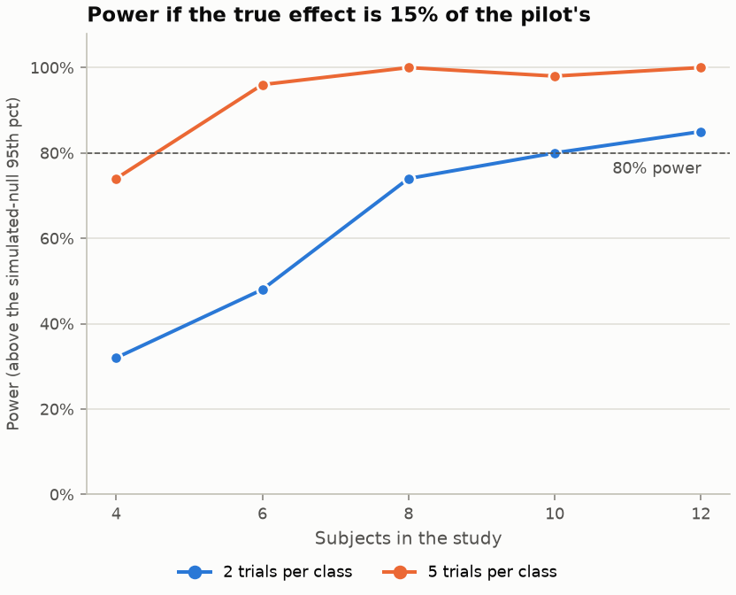

# subjectwise-ml

[](https://github.com/juanbezerra1/subjectwise-ml/actions/workflows/ci.yml)


*Leia em português: [README.pt-BR.md](README.pt-BR.md)*

**Honest validation for classifiers trained on a handful of subjects.**

Biosignal studies (EEG, EMG, force, ...) often have 8-20 participants and a few dozen trials each.
Trials from one person resemble each other, so a random train/test split lets the model "recognise
the person" and the accuracy comes out too good. `subjectwise` is a small, tested toolkit for
evaluating such data without fooling yourself: leakage-free cross-validation, a permutation test
that respects the subject structure, subject-level statistics, and simulation-based power analysis.

| | |
|---|---|
| `audit` | catches mistakes that bias results *before* any model is trained: missing classes, tiny or duplicated subjects (a copied recording), imbalance, NaN |
| `evaluate`, `compare_schemes` | random split vs. leave-one-subject-out (LOSO); headline = mean of per-subject accuracies ± SD across subjects |
| `within_group_zscore` | removes between-person scale differences without using labels; optional log scale for positive, multiplicative features (RMS, power) |
| `permutation_test` | chance level of the *whole pipeline*, shuffling labels inside each subject |
| `leave_group_out` | how much does each subject move the result? |
| `correlation_report` | pooled vs. within-subject vs. subject-level correlation (Simpson's paradox) |
| `HierarchicalGenerator` | simulates new, plausible subjects from a small pilot, with a calibration check |
| `power_curve` | "how many subjects do I need?", by simulating whole studies |

## Try it

```bash
pip install git+https://github.com/juanbezerra1/subjectwise-ml.git
subjectwise demo --out demo            # about 90 s; add --quick for a 5 s rough run
```

The demo builds a **synthetic** cohort (8 subjects, 20 trials each, 4 classes, chance = 25%, strong
between-person differences in gain) and writes `report.md`, CSV tables, figures and `summary.json`
to `demo/`. With seed 0:

| validation | LDA accuracy |
|---|---|
| random split (what many papers report) | 65.0% |
| leave-one-subject-out | 56.9% |
| LOSO + within-subject z-score | **90.6%** (± 12.9 points across subjects) |



The honest number is then tested against chance by shuffling labels inside each subject 500 times
and repeating the whole LOSO pipeline (null 95th percentile 31.9%, p = 0.002), and the per-subject
view shows that one subject sits far below the others:



Finally, the generator fitted on those 8 subjects simulates whole studies to ask how many subjects
a replication would need. Pilots tend to overstate effects, so the curve below assumes the true
effect is only 15% of the pilot's:



## Use it on your own data

One row per trial (or window), as a CSV: a subject column, a class label, an optional numeric
covariate (for example the produced force), and numeric feature columns. The layout is the one
written by [`biosigkit`](https://github.com/juanbezerra1/biosigkit), so its feature tables work as they
are (`<channel>_<feature>` columns; `subject`, `session`, `trial`, `level`, `x`, ... are never
treated as features).

```bash
subjectwise check    features.csv --label level --group subject
subjectwise evaluate features.csv --label level --group subject --log-features emg1_rms,emg2_rms
subjectwise power    features.csv --x force_pct --effect 0.5 --subjects 6,8,10,12 --trials 3,5
```

or from Python:

```python
import subjectwise as sw

df = sw.read_table("features.csv")
features = sw.infer_features(df, exclude=["force_pct"])

print(sw.audit(df, features, label="level", group="subject").format())
table = sw.compare_schemes(df, features, "level", "subject", log_features=["emg1_rms"])
print(sw.leakage_gap(table))
perm = sw.permutation_test(
    df,
    features,
    "level",
    "subject",
    normalize="within_group",
    log_features=["emg1_rms"],
    n_perm=1000,
    n_jobs=-1,
)
print(perm.summary())
```

`examples/quickstart.py` runs the whole tour on the synthetic cohort in about 20 seconds.

## Design decisions and honest limits

* **The headline is the mean of per-subject accuracies.** Pooling rows lets a subject with 80
  trials weigh four times as much as one with 20. The pooled balanced accuracy is reported next
  to it.
* **Chance is not always 1/K.** With unbalanced classes a model that always answers the common
  class already beats it, and `audit` reports that baseline. The permutation test shuffles labels
  *inside* each subject, which keeps every subject's class composition and destroys only the link
  between features and labels.
* **Within-subject z-scoring is transductive.** It never uses labels, so LOSO stays leakage-free,
  but a new user needs an unlabelled calibration block that covers the task's range. A jump like
  57% → 91% also says the raw features were dominated by between-person scale.
* **The classical tests for power are liberal, so `power_curve` is calibrated by simulation.** On
  simulated studies with *no* effect (800 per design, Monte-Carlo SE about 1 point), a one-sided
  t-test over subjects calls 6-8% of them significant at a nominal 5% (with or without
  normalisation), and a pooled binomial test 7-9% with within-subject z-scoring (4-6% without).
  `power_curve` therefore reports power against the 95th percentile of the simulated null of the
  same design and pipeline, which has a 5% false-positive rate by construction; the two tests
  stay in the table for comparison, with `PowerResult.false_positive_rates()` to measure them.
  Reproduce with `examples/false_positive_study.py`. The within-subject permutation test, checked
  the same way on 200 null studies, rejected 7.0% at α = 0.05 and 10.5% at α = 0.10 (SE about 2
  points): consistent with a valid test.
* **The generator is a model, not the truth.** It is Gaussian, linear in the covariate and can only
  reproduce what the pilot shows. With `k` pilot subjects the between-subject spread is uncertain
  (`spread_interval()`: about 0.66-2.0 times for k = 8), and `calibration_check` measures how well
  held-out pilot subjects fall inside simulated ones (88% inside the 5-95 band in the demo; about
  90% expected). Treat a power curve as a planning aid, not a sample-size guarantee.
* **The demo data are not physiology.** They only have the statistical shape of small studies.

More detail, with formulas: [`docs/method.md`](docs/method.md).

## Development

```bash
pip install -e ".[dev]"
pytest                                   # tests, plus a quick run of the demo
ruff check . && ruff format --check . && mypy src
```

CI runs the tests on Python 3.10-3.13 (Linux) and on Python 3.10 and 3.13 (Windows), once with the oldest
allowed version of every direct dependency, lint and types, and installs the built wheel in a clean
environment (Linux and Windows) to run `subjectwise demo --quick`.

## Related

[`biosigkit`](https://github.com/juanbezerra1/biosigkit) turns raw EMG/EEG/force recordings into the
feature tables that this package evaluates.

## License

MIT, see [LICENSE](LICENSE).
