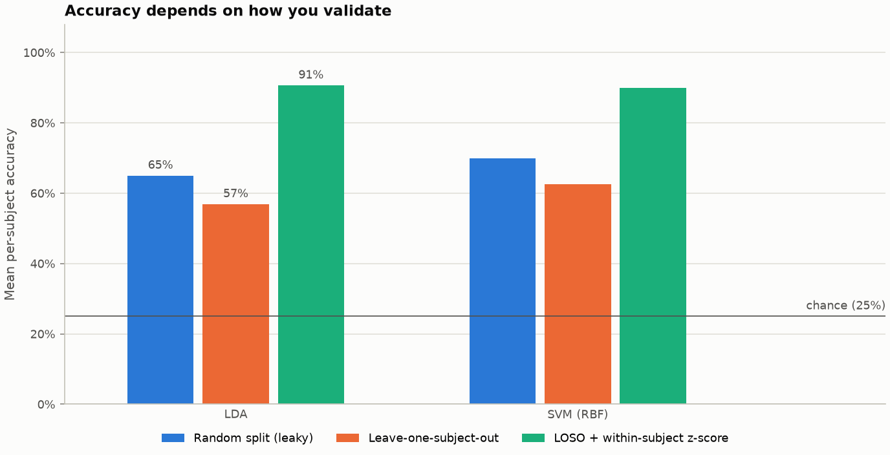
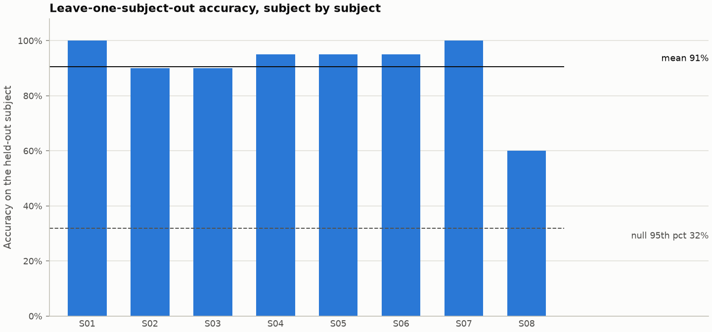
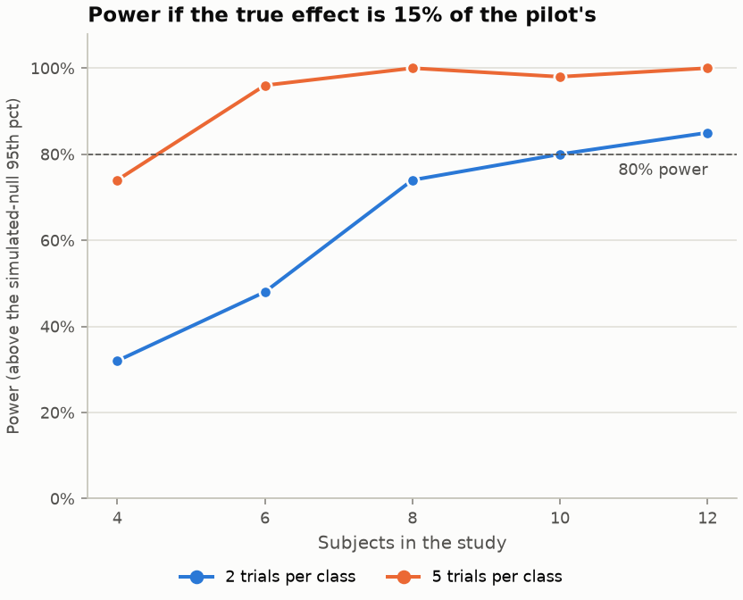

# subjectwise-ml

[](https://github.com/juanbezerra1/subjectwise-ml/actions/workflows/ci.yml)


*Read in English: [README.md](README.md)*

**Validação honesta para classificadores treinados com poucos participantes.**

Estudos com biossinais (EEG, EMG, força, ...) costumam ter de 8 a 20 participantes e algumas dezenas
de tentativas cada. As tentativas de uma mesma pessoa se parecem, então uma divisão aleatória em
treino e teste deixa o modelo "reconhecer a pessoa", e a acurácia sai boa demais. O `subjectwise` é
um conjunto pequeno e testado de ferramentas para avaliar esse tipo de dado sem se enganar:
validação cruzada sem vazamento, teste de permutação que respeita a estrutura por participante,
estatísticas no nível do participante e análise de poder por simulação.

| | |
|---|---|
| `audit` | pega erros que enviesam o resultado *antes* de treinar qualquer modelo: classe ausente, participante com poucas linhas ou duplicado (gravação copiada), desbalanceamento, NaN |
| `evaluate`, `compare_schemes` | divisão aleatória vs. leave-one-subject-out (LOSO); número principal = média das acurácias por participante ± DP entre participantes |
| `within_group_zscore` | remove diferenças de escala entre pessoas sem usar os rótulos; escala log opcional para variáveis positivas e multiplicativas (RMS, potência) |
| `permutation_test` | nível de acaso do *pipeline inteiro*, embaralhando os rótulos dentro de cada participante |
| `leave_group_out` | quanto cada participante move o resultado? |
| `correlation_report` | correlação agrupada vs. intra-participante vs. no nível do participante (paradoxo de Simpson) |
| `HierarchicalGenerator` | simula participantes novos e plausíveis a partir de um piloto pequeno, com checagem de calibração |
| `power_curve` | "de quantos participantes eu preciso?", simulando estudos inteiros |

## Experimente

```bash
pip install git+https://github.com/juanbezerra1/subjectwise-ml.git
subjectwise demo --out demo            # cerca de 90 s; com --quick, uma versão rápida em 5 s
```

O demo monta uma coorte **sintética** (8 participantes, 20 tentativas cada, 4 classes, acaso = 25%,
grandes diferenças de ganho entre pessoas) e grava `report.md`, tabelas CSV, figuras e
`summary.json` em `demo/`. Com a semente 0:

| validação | acurácia (LDA) |
|---|---|
| divisão aleatória (o que muito artigo reporta) | 65,0% |
| leave-one-subject-out | 56,9% |
| LOSO + z-score por participante | **90,6%** (± 12,9 pontos entre participantes) |



O número honesto é então comparado ao acaso embaralhando os rótulos dentro de cada participante 500
vezes e repetindo todo o LOSO (percentil 95 do nulo: 31,9%; p = 0,002). A visão por participante
mostra que um deles fica bem abaixo dos demais:



Por fim, o gerador ajustado nesses 8 participantes simula estudos inteiros para perguntar quantos
participantes uma replicação precisaria. Pilotos costumam exagerar o efeito, então a curva abaixo
supõe que o efeito verdadeiro seja só 15% do observado no piloto:



## Use com os seus dados

Uma linha por tentativa (ou janela), em CSV: coluna de participante, rótulo da classe, uma covariável
numérica opcional (por exemplo a força produzida) e colunas numéricas de variáveis. O formato é o
que o [`biosigkit`](https://github.com/juanbezerra1/biosigkit) grava, então as tabelas dele funcionam
sem mudanças (colunas `<canal>_<variável>`; `subject`, `session`, `trial`, `level`, `x`, ... nunca
são tratadas como variáveis).

```bash
subjectwise check    variaveis.csv --label level --group subject
subjectwise evaluate variaveis.csv --label level --group subject --log-features emg1_rms,emg2_rms
subjectwise power    variaveis.csv --x force_pct --effect 0.5 --subjects 6,8,10,12 --trials 3,5
```

ou em Python:

```python
import subjectwise as sw

df = sw.read_table("variaveis.csv")
features = sw.infer_features(df, exclude=["force_pct"])

print(sw.audit(df, features, label="level", group="subject").format())
table = sw.compare_schemes(df, features, "level", "subject", log_features=["emg1_rms"])
print(sw.leakage_gap(table))
perm = sw.permutation_test(
    df,
    features,
    "level",
    "subject",
    normalize="within_group",
    log_features=["emg1_rms"],
    n_perm=1000,
    n_jobs=-1,
)
print(perm.summary())
```

`examples/quickstart.py` roda o roteiro completo na coorte sintética em cerca de 20 segundos.

## Decisões de projeto e limites

* **O número principal é a média das acurácias por participante.** Agrupar linhas faz um
  participante com 80 tentativas pesar quatro vezes mais que um com 20. A acurácia balanceada
  agrupada é reportada ao lado.
* **Acaso nem sempre é 1/K.** Com classes desbalanceadas, um modelo que sempre responde a classe
  mais comum já passa disso, e o `audit` mostra essa linha de base. O teste de permutação embaralha
  os rótulos *dentro* de cada participante: mantém a composição de classes de cada um e destrói só
  a ligação entre variáveis e rótulos.
* **O z-score por participante é transdutivo.** Ele nunca usa rótulos, então o LOSO continua sem
  vazamento, mas um usuário novo precisa de um bloco de calibração sem rótulos que cubra a faixa da
  tarefa. Um salto como 57% → 91% também indica que as variáveis brutas eram dominadas pela escala
  entre pessoas.
* **Os testes clássicos de poder são liberais, então o `power_curve` é calibrado por simulação.**
  Em estudos simulados *sem* efeito (800 por desenho, erro de simulação de cerca de 1 ponto), o teste
  t unilateral entre participantes aponta 6-8% como significativos para um nominal de 5% (com ou sem
  normalização), e o teste binomial agrupado 7-9% com z-score por participante (4-6% sem). Por isso o
  `power_curve` reporta o poder contra o percentil 95 do nulo simulado do mesmo desenho e pipeline,
  que tem 5% de falso positivo por construção; os dois testes ficam na tabela para comparação, e
  `PowerResult.false_positive_rates()` mede as taxas. Reproduza com
  `examples/false_positive_study.py`. O teste de permutação intra-participante, verificado do mesmo
  modo em 200 estudos nulos, rejeitou 7,0% a α = 0,05 e 10,5% a α = 0,10 (erro de cerca de 2
  pontos): consistente com um teste válido.
* **O gerador é um modelo, não a verdade.** É gaussiano, linear na covariável e só reproduz o que o
  piloto mostra. Com `k` participantes no piloto a dispersão entre participantes é incerta
  (`spread_interval()`: de 0,66 a 2,0 vezes para k = 8), e `calibration_check` mede quão bem
  participantes do piloto deixados de fora caem dentro dos simulados (88% dentro da faixa 5-95 no
  demo; cerca de 90% esperado). Trate a curva de poder como apoio ao planejamento, não como garantia
  de tamanho de amostra.
* **Os dados do demo não são fisiologia.** Eles só têm o formato estatístico de estudos pequenos.

Mais detalhes, com fórmulas: [`docs/method.md`](docs/method.md) (em inglês).

## Desenvolvimento

```bash
pip install -e ".[dev]"
pytest                                   # testes, incluindo uma execução rápida do demo
ruff check . && ruff format --check . && mypy src
```

O CI roda os testes no Python 3.10-3.13, uma vez com a versão mais antiga permitida de cada
dependência direta, lint e tipos, e instala o wheel gerado num ambiente limpo para rodar
`subjectwise demo --quick`.

## Relacionado

O [`biosigkit`](https://github.com/juanbezerra1/biosigkit) transforma gravações brutas de EMG/EEG/força
nas tabelas de variáveis que este pacote avalia.

## Licença

MIT, veja [LICENSE](LICENSE).
